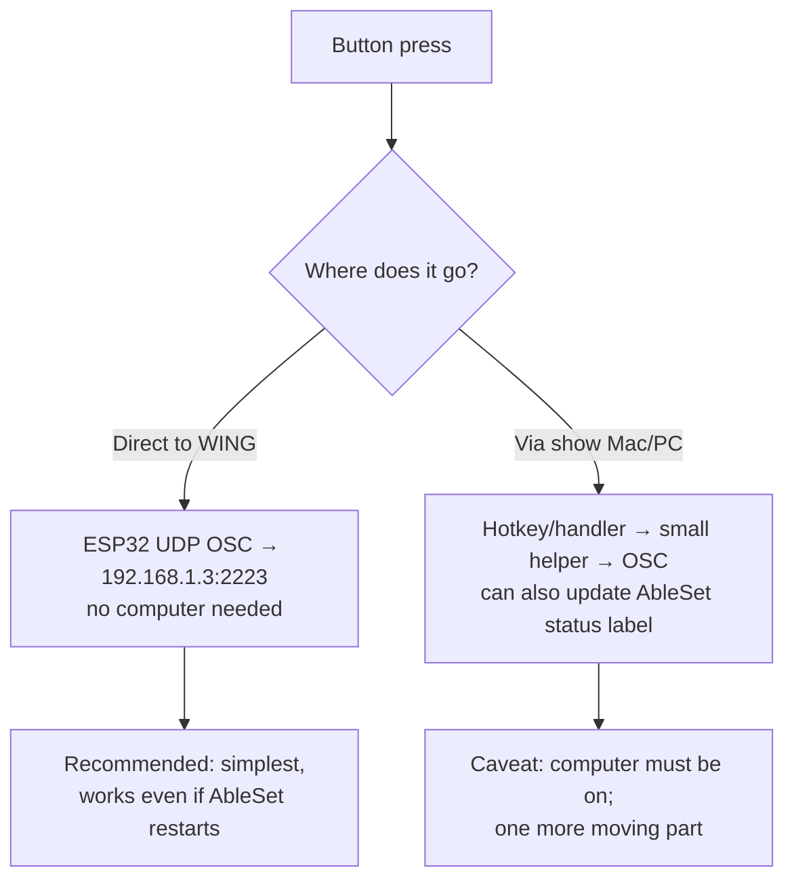

# StageCraft ALT Controls

Foot switches, handheld buttons and AirPods gestures for the StageCraft show's **ALT toggles**
(live mic ↔ pre-recorded backing on the WING desk).

This repo is **new and untested hardware-wise**. The show currently works with AbleSet phone canvases
(`ALT-KICK`, `ALT-BASS`, `ALT-FLUTE`, `ALT-VOCALS`, `ALT-GUITAR`, `ALT-TEST`). Any device built here is
a convenience layer that sends the **same OSC** — the phone canvases stay as the fallback.

> No AI, internet or MCP is needed at show time. Everything here is local OSC on the show network.

## The one fact that makes this simple

The WING already exposes the ALT switch as a normal OSC parameter:

```
/ch/<N>/in/set/altsrc   0 = MAIN (live mic)    1 = ALT (backing)
WING IP 192.168.1.3, OSC control UDP 2223
```

So a foot switch does **not** need AbleSet, AbleBridgePlus, a computer or an AI. It is an ESP32 with
WiFi that sends one UDP OSC packet to `192.168.1.3:2223`. See
[docs/PROTOCOL-EVIDENCE.md](docs/PROTOCOL-EVIDENCE.md) for the verified details (including the
integer-tag trap).

## Planned members

| Member | Interface | Status |
|---|---|---|
| Guitar | ESP32 foot switch + display | design |
| Flute | ESP32 foot switch + display | design |
| Bass | ESP32 foot switch + display | design |
| Drummer | **open question** — feet are busy with kick/hi-hat; maybe a hand button or a trigger pad | ask human |
| Vocalist | **open question** — handheld button vs AirPods/AirCursor | ask human |

## Options considered



| Option | Pros | Cons |
|---|---|---|
| **B. Devices → AbleSet → WING (recommended)** | AbleSet stays the show brain; one place holds the channel map (`project-script.js`); canvas status label can follow the hardware switch; devices only need AbleSet's IP/port, not WING OSC details | Needs AbleSet running (it is) and one project-script change + AbleSet restart; must verify AbleSet fires `onOscChange` for the custom address |
| A. ESP32 directly to WING | No computer, no app, no cloud; simplest packet | Canvas status label will not follow the switch; channel map duplicated in every device |
| C. AirPods + AirCursor (vocalist) | No new hardware to carry | Needs a supported AirPods model, macOS 15+, permissions, AirPods playing audio on the Mac; gesture mis-triggers possible |
| D. BLE photo-remote / small handheld | Very cheap, no WiFi setup | Needs a Mac receiver; button mapping varies |

### Does this need `/subscribe`? — **No**

`/subscribe` is only for an **AI client reading which song/section is playing**. It is not part of the
show automation at all. The FX script and every ALT canvas already work without it, and Option B
keeps that property: a device sends one OSC command to AbleSet (UDP 39051), AbleSet's project script
sends the WING OSC. No AI, no MCP, no subscription. See
[docs/ABLESET-CONTROL.md](docs/ABLESET-CONTROL.md).

## Where things live

| Path | What |
|---|---|
| `docs/PROTOCOL-EVIDENCE.md` | Verified WING OSC facts and pitfalls |
| `docs/HARDWARE-PLAN.md` | ESP32, display, power, enclosure, per-member config |
| `docs/AIRPODS.md` | AirCursor assessment for the vocalist |
| `firmware/esp32/` | **Prototype** Arduino/PlatformIO skeleton (not hardware-tested) |
| `mac/` | Prototype helper that turns a hotkey into the same OSC packet |

## Questions for the human before building

1. Which **AirPods model** does the vocalist have? AirCursor needs AirPods Pro, AirPods Max,
   AirPods 3rd gen+, or Beats Fit Pro (head-motion sensors).
2. Drummer: foot switch or hand button? (Feet already on kick/hi-hat.)
3. Should the canvas status label follow the hardware switch? That decides Option A vs B.
4. Display content: `MAIN` / `ALT`, WiFi status, battery — how much is useful on a dark stage?

## Related

[ableset-show-profile](https://github.com/mhzsajan/ableset-show-profile) ·
[Behringer-Wings-MCP-Server](https://github.com/mhzsajan/Behringer-Wings-MCP-Server) ·
[AirCursor](https://github.com/m-afham/AirCursor) (third-party, MIT — not affiliated with this repo).
