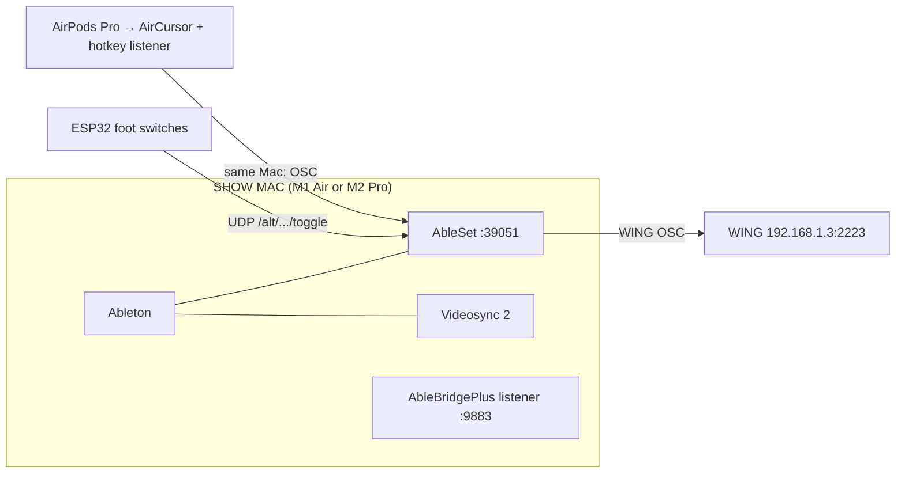
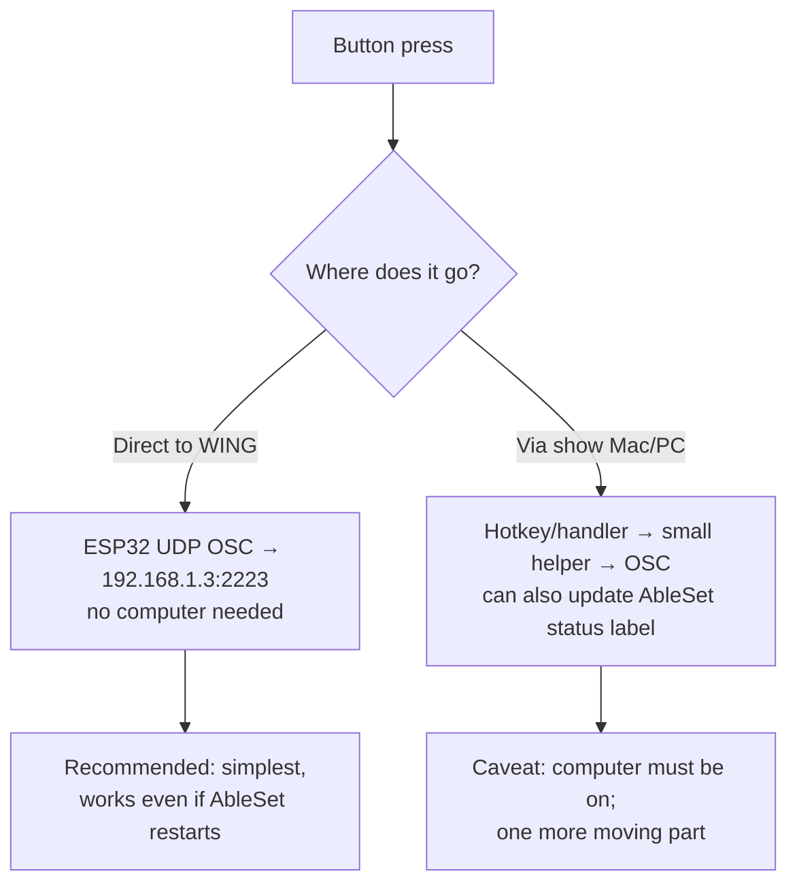

# StageCraft ALT Controls

Foot switches, handheld buttons and AirPods gestures for the StageCraft show's **ALT toggles**
(live mic ↔ pre-recorded backing on the WING desk).

This repo is **new and untested hardware-wise**. The show currently works with AbleSet phone canvases
(`ALT-KICK`, `ALT-BASS`, `ALT-FLUTE`, `ALT-VOCALS`, `ALT-GUITAR`, `ALT-TEST`). Any device built here is
a convenience layer that sends the **same OSC** — the phone canvases stay as the fallback.

> No AI, internet or MCP is needed at show time. Everything here is local OSC on the show network.

## Show topology (confirmed 2026-11-18)

The rig uses **one show MacBook** — either the M1 Air or the M2 Pro, chosen per show — and on that
**same machine** Ableton, AbleSet and Videosync 2 all run together for the live backing tracks.



Good consequences:

- The AUDIO-PROFILES canvas uses `127.0.0.1:9883` — with Ableton and AbleSet on the same Mac this
  works naturally. It must be opened in **AbleSet on the show Mac**, not on a band member's phone.
- The ALT toggle OSC goes to AbleSet on that Mac (UDP 39051), so ESP32 devices only need that Mac's
  IP, which must be stable (DHCP reservation — see [HARDWARE-PLAN.md](docs/HARDWARE-PLAN.md)).
- AirCursor and the hotkey listener for the vocalist's AirPods run on that **same** show Mac, so the
  OSC hop is local. Watch for "Now Playing" conflicts with Ableton/Videosync — see
  [AIRPODS.md](docs/AIRPODS.md).

## The one fact that makes this simple

The WING already exposes the ALT switch as a normal OSC parameter:

```
/ch/<N>/in/set/altsrc   0 = MAIN (live mic)    1 = ALT (backing)
WING IP 192.168.1.3, OSC control UDP 2223
```

So a foot switch does **not** need AbleSet, AbleBridgePlus, a computer or an AI. It is an ESP32 with
WiFi that sends one UDP OSC packet to `192.168.1.3:2223`. See
[docs/PROTOCOL-EVIDENCE.md](docs/PROTOCOL-EVIDENCE.md) for the verified details (including the
integer-tag trap).

## Planned members

| Member | Interface | Status |
|---|---|---|
| Guitar | ESP32 foot switch + display | design |
| Flute | ESP32 foot switch + display | design |
| Bass | ESP32 foot switch + display | design |
| Drummer | **open question** — feet are busy with kick/hi-hat; maybe a hand button or a trigger pad | ask human |
| Vocalist | **open question** — handheld button vs AirPods/AirCursor | ask human |

## Options considered



| Option | Pros | Cons |
|---|---|---|
| **A. ESP32 directly to WING (RECOMMENDED)** | The user's live test (iPhone, Android, second iPhone) proves the canvases work across phones and that the WING accepts OSC generated on the network. The WING MCP also successfully sends OSC from this PC. A phone browser cannot send UDP itself — the AbleSet desktop app relays the packet — but the WING side is proven, and an ESP32 can send the same UDP packet directly. No AbleSet inbound, no subscribe, no computer dependency | Canvas status label will not follow a hardware switch (cosmetic); each device holds its own channel number. An ESP32 device sending directly has not itself been bench-tested yet |
| B. Devices → AbleSet → WING (experimental) | One place holds the channel map; canvas status label can follow the switch | **Depends on an unproven capability** — see the warning in [ABLESET-CONTROL.md](docs/ABLESET-CONTROL.md). Do not build around it until tested |
| C. AirPods + AirCursor (vocalist) | No new hardware to carry | Needs a supported AirPods model, macOS 15+, permissions, AirPods playing audio on the Mac; gesture mis-triggers possible |
| D. BLE photo-remote / small handheld | Very cheap, no WiFi setup | Needs a Mac receiver; button mapping varies |

> **Why the recommendation is direct-to-WING:** the earlier plan assumed devices would send OSC into
> AbleSet on UDP 39051 — still unverified. The canvas `onPress` contains a raw target
> `192.168.1.3:2223/ch/N/in/set/altsrc 0|1`; the phone is only the UI client, and the **AbleSet desktop
> app** sends that UDP OSC to the WING (a browser cannot send UDP). The user's phone test proves the
> WING accepts network OSC, and the WING MCP does the same from this PC — so an ESP32 sending the
> identical packet is the lowest-risk path. Evidence:
> [PROTOCOL-EVIDENCE.md](docs/PROTOCOL-EVIDENCE.md) and
> `ableset-show-profile/docs/ABLESET-DIAGRAMS.md` L40/L45/L58.

### Does this need `/subscribe`? — **No**

`/subscribe` is only for an **AI client reading which song/section is playing**. It is not part of the
show automation at all. The FX script and every ALT canvas already work without it, and Option B
keeps that property: a device sends one OSC command to AbleSet (UDP 39051), AbleSet's project script
sends the WING OSC. No AI, no MCP, no subscription. See
[docs/ABLESET-CONTROL.md](docs/ABLESET-CONTROL.md).

## Where things live

| Path | What |
|---|---|
| `docs/PROTOCOL-EVIDENCE.md` | Verified WING OSC facts and pitfalls |
| `docs/HARDWARE-PLAN.md` | ESP32, display, power, enclosure, per-member config |
| `docs/AIRPODS.md` | AirCursor assessment for the vocalist |
| `firmware/esp32/` | **Prototype** Arduino/PlatformIO skeleton (not hardware-tested) |
| `mac/` | Prototype helper that turns a hotkey into the same OSC packet |

## Questions for the human before building

1. ~~Which AirPods model?~~ **Answered: AirPods Pro**, with M1 Air + M2 Pro on current macOS —
   AirCursor requirements are met. Stem-double-press mapping is documented in
   [docs/AIRPODS.md](docs/AIRPODS.md); still needs a live rehearsal test.
2. Drummer: foot switch or hand button? (Feet already on kick/hi-hat.)
3. Should the canvas status label follow the hardware switch? That decides Option A vs B.
4. Display content: `MAIN` / `ALT`, WiFi status, battery — how much is useful on a dark stage?
5. ~~Which Mac runs the rig?~~ **Answered:** one show Mac (M1 Air or M2 Pro per show) runs Ableton +
   AbleSet + Videosync together. **Still to decide:** do the two Macs swap, or is one always the show
   Mac? If they swap, we should reserve one DHCP IP for the "show Mac" role (or use mDNS) so the
   ESP32 config does not have to change between shows.

## Related

[ableset-show-profile](https://github.com/mhzsajan/ableset-show-profile) ·
[Behringer-Wings-MCP-Server](https://github.com/mhzsajan/Behringer-Wings-MCP-Server) ·
[AirCursor](https://github.com/m-afham/AirCursor) (third-party, MIT — not affiliated with this repo).
