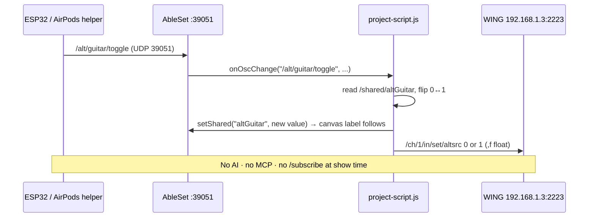

# Option B (experimental): devices → AbleSet → WING

> **Status: not recommended for the first build.** The user's live test (2026-11-18) showed that
> phones toggling from AbleSet canvases work, but the phone is only a UI client: the **AbleSet desktop
> app** sends the raw UDP OSC (`192.168.1.3:2223/ch/N/in/set/altsrc`) to the WING. That test proves the
> WING side works, not that an external device can send a command *into* AbleSet on UDP 39051. Option
> A (direct-to-WING) is therefore the recommended first build. Keep this page for a later improvement
> where AbleSet also owns the state/label.

The idea: keep **AbleSet as the show brain**. A foot switch or an AirPods gesture sends a tiny OSC
command to AbleSet; AbleSet's Project Script does the real WING OSC and updates the canvas status
label. Devices never need to know the WING IP, the OSC address format or the channel map.

## Why no `/subscribe`

`/subscribe` has exactly one purpose: an **AI client** asks AbleSet to push "which song/section is
playing" to it (AbleBridgePlus listens on UDP 39052). It is not a command channel and it has nothing
to do with ALT toggles or FX. Source: `ableset-show-profile/docs/WHY-THESE-SETTINGS.md`:

- *"A recurring question: do we need to subscribe for reverb/delay to turn on at song start…"* →
  **no**; the script sends raw OSC directly.
- *"`/subscribe` is only relevant when an AI/bridge client wants to read what song/section is playing."*
- AbleSet listens on UDP **39051**; the bridge listener is **39052**.
- AbleSet forgets subscriptions on restart, yet FX and ALT keep working.

So the answer is: **correct — no subscription needs to be kept alive** for the new switches, just as
none is needed today.

## Proposed command addresses

| Device | OSC message to AbleSet (UDP 39051) | WING target written by the script |
|---|---|---|
| Guitar foot switch | `/alt/guitar/toggle` | `/ch/1/in/set/altsrc` |
| Bass foot switch | `/alt/bass/toggle` | `/ch/9/in/set/altsrc` |
| Flute foot switch | `/alt/flute/toggle` | `/ch/10/in/set/altsrc` |
| Vocalist (button or AirPods) | `/alt/vocals/toggle` | `/ch/12`, `/ch/15`, `/ch/16` |
| Drummer (button/pad) | `/alt/drums/toggle` | **TBD** — which WING channel? |

A "toggle" message carries no meaningful value; the script flips the state. This makes the device
stateless (no need to remember whether it is currently MAIN or ALT) and means a phone canvas and a
foot switch always agree, because AbleSet owns the state.

## What must be verified before committing to this design

1. **Inbound custom OSC on AbleSet — the critical unknown.** Confirm a device UDP packet to the
   **show Mac's reserved IP:39051** with an arbitrary address such as `/alt/guitar/toggle` actually
   reaches the Project Script's `onOscChange()` handler. Two separate things are untested:
   - `onOscChange()` for a *custom* address (the existing script only proves `/global/isPlaying`).
   - AbleSet listening on a **remote** interface at all — the documented `/subscribe` examples all
     go through the local `http://127.0.0.1/settings/osc` tester, which does not prove network input.

   Test this first, before building five switches. If it fails, use the fallback below (direct to
   WING) — it is already proven by the existing phone canvases and needs no AbleSet inbound.
2. **`setShared()` from the script updates the canvas label.** The canvases read
   `osc("/shared/altGuitar")` for their status text, so this should work, but verify.
3. **No double-send.** The existing phone canvases already send WING OSC directly AND set the shared
   variable. Watch only the new `/alt/*/toggle` addresses, **not** `/shared/alt*`, so a phone button
   press does not cause the script to send a second (harmless but confusing) WING packet.
4. **Float tag.** WING silently ignores integer-tagged numeric SETs — send whole numbers as `,f`
   floats (see [PROTOCOL-EVIDENCE.md](PROTOCOL-EVIDENCE.md)).

## Fallback if custom inbound OSC is not supported

Keep the phone canvases exactly as they are and let the hardware send the WING OSC directly
(Option A in the README). It is slightly less elegant but already proven: the existing canvases do
the same thing on every show.

## Related

[README.md](../README.md) ·
[ableset-show-profile — ABLESET-DIAGRAMS.md](https://github.com/mhzsajan/ableset-show-profile/blob/master/docs/ABLESET-DIAGRAMS.md) ·
[ableset-show-profile — WHY-THESE-SETTINGS.md](https://github.com/mhzsajan/ableset-show-profile/blob/master/docs/WHY-THESE-SETTINGS.md)
